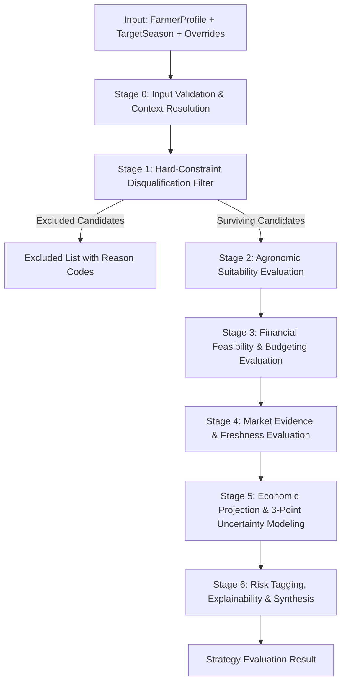
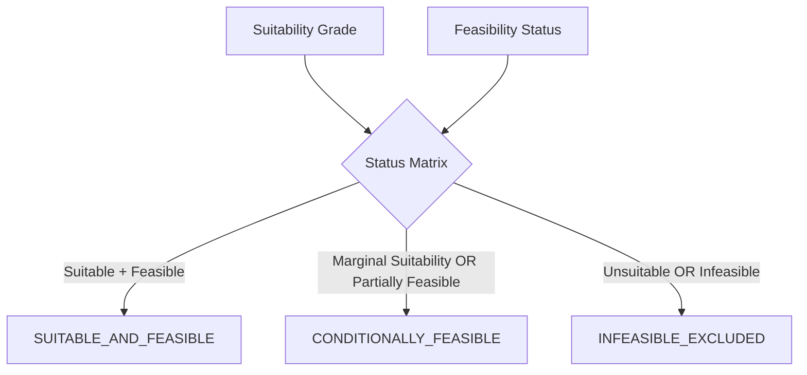

# Baseline Strategy Engine Algorithm & Decision Rules

**Platform:** AI Farm Strategy & Decision Engine  
**Document:** Baseline Deterministic Decision Algorithm Specification  
**Phase:** 3A (Design & Specification)  
**Status:** DRAFT / PENDING APPROVAL  

---

## 1. Algorithmic Principles & Rationale

Before introducing any machine learning models, statistical meta-heuristics, or external AI API calls, the AI Farm Strategy Engine must establish a **deterministic, rule-based baseline algorithm**.

### Key Design Mandates
1. **Explainable by Design:** Every recommendation, conditional warning, and exclusion must map directly to explicit agronomic, financial, or market evidence.
2. **Deterministic & Reproducible:** The algorithm is a pure, idempotent function of its inputs:
   $$\text{Evaluate}(\text{FarmerProfile}, \text{TargetSeason}, \text{Overrides}, \text{ReferenceData}, \text{MarketData}) \to \text{Result}$$
   Given the identical inputs, it will produce bitwise identical assessments, calculations, and explanations every time.
3. **No Monolithic Black-Box Scores:** The engine evaluates three independent axes:
   - **Agronomic Suitability** ($\mathcal{S}_{agro}$)
   - **Financial Feasibility** ($\mathcal{F}_{fin}$)
   - **Market Attractiveness** ($\mathcal{M}_{mkt}$)
4. **Three-Point Economic Uncertainty:** Single-point yield and profit predictions are scientifically indefensible in agriculture due to weather, pest, and market volatility. The engine models Conservative ($C$), Modal ($M$), and Optimistic ($O$) scenarios.
5. **Conservative Safety Guardrails:** Strict prohibition of guaranteed-profit language. Explicit separation of gross wholesale revenue from net farmer income.

---

## 2. Multi-Stage Pipeline Overview

The evaluation executes as a linear six-stage pipeline:



---

## 3. Detailed Algorithmic Stages

---

### Stage 0: Input Validation & Context Resolution

1. **Verify Land Scale:**
   - Let $A_{cultivable}$ be `cultivableHectaresOverride` if provided; otherwise `FarmerProfile.cultivableHectares`.
   - If $A_{cultivable}$ is null, check `FarmerProfile.totalLandHectares`.
   - If both are null or $A_{cultivable} \le 0$, halt evaluation with error `UNPROCESSABLE_ENTITY: Cultivable land area must be greater than zero.`
2. **Verify Geographic Location:**
   - Let $S$ be `primaryState`, $D$ be `primaryDistrict`.
   - If $S$ or $D$ is blank/null, halt evaluation with error `UNPROCESSABLE_ENTITY: Farm state and district are required.`
3. **Resolve Capital Budget:**
   - Let $K$ be `workingCapitalOverride` if provided; otherwise `FarmerProfile.workingCapitalInr`.
   - If $K$ is null, set flag `IS_CAPITAL_UNREPORTED = true`.
4. **Resolve Candidate Crop Pool:**
   - Query all active `CropMaster` entries configured for `targetSeason`.

---

### Stage 1: Hard-Constraint Disqualification Filter

A candidate crop $i$ is immediately disqualified and moved to `excludedCrops` if it violates any of the four absolute constraints:

#### Rule HC-1: Target Season Mismatch
$$\text{SeasonMismatch}(i) \iff \text{targetSeason} \notin \text{CropSeasons}(i)$$
- **Disqualification Code:** `OFF_SEASON`
- **Explanation:** *"Candidate crop [CropName] is traditionally grown during [CropSeasons] and cannot be sown during target season [TargetSeason]."*

#### Rule HC-2: Soil Incompatibility
$$\text{SoilIncompatible}(i) \iff \text{FarmerProfile.soilType} \ne \text{null} \land \text{Compatibility}(\text{soilType}, i) = \text{INCOMPATIBLE}$$
- **Disqualification Code:** `INCOMPATIBLE_SOIL`
- **Explanation:** *"Farmer's soil type [SoilType] is agronomically incompatible with [CropName]. [SoilNotes]."*
- *Note on Missing or Unclassified Data:* If `FarmerProfile.soilType` is null or `OTHER`, or if $\text{Compatibility}(\text{soilType}, i) = \text{UNKNOWN}$, Rule HC-2 is bypassed; the crop is preserved with an `UNREPORTED_SOIL_TYPE` warning. Unclassified soil data never triggers hard disqualification.

#### Rule HC-3: Water Availability Deficit
$$\text{WaterDeficit}(i) \iff \text{waterAvailabilityMonths} \ne \text{null} \land \text{waterAvailabilityMonths} < \text{MinWaterMonths}(i) \land \text{irrigationSource} \ne \text{PERENNIAL}$$
- **Disqualification Code:** `WATER_AVAILABILITY_DEFICIT`
- **Explanation:** *"Crop requires at least [MinWaterMonths] months of reliable water access, but farm reports only [WaterMonths] months."*
- *Note on Perennial Sources:* If `irrigationSource` is `BOREWELL`, `CANAL`, or `RIVER`, and water availability is unrecorded, rule is bypassed with an assumption warning.

#### Rule HC-4: Extreme Working Capital Shortfall
$$\text{CapitalShortfall}(i) \iff \neg\text{IS\_CAPITAL\_UNREPORTED} \land K < (A_{min\_viable} \times \text{CostPerHa}_{A2}(i))$$
Where $A_{min\_viable}$ is the minimum viable plot size (default: $0.10$ hectares) and $\text{CostPerHa}_{A2}$ is paid-out variable cultivation cost.
- **Disqualification Code:** `INSUFFICIENT_WORKING_CAPITAL`
- **Explanation:** *"Available working capital (₹[K]) is insufficient to cultivate the minimum viable parcel (0.1 ha requires at least ₹[MinCost])."*

---

### Stage 2: Agronomic Suitability Evaluation

For surviving crops, calculate individual environmental suitability components:

#### 1. Soil Compatibility Sub-score
- If `soilType` is null or `Compatibility(soilType, i) == UNKNOWN` $\implies$ `MODERATELY_SUITABLE` (Flag: `UNREPORTED_SOIL_TYPE`).
- If `Compatibility(soilType, i) == HIGHLY_SUITABLE` $\implies$ Soil Fit = `HIGH`.
- If `Compatibility(soilType, i) == MODERATELY_SUITABLE` $\implies$ Soil Fit = `MODERATE`.
- If `Compatibility(soilType, i) == MARGINAL` $\implies$ Soil Fit = `MARGINAL`.

#### 2. Water Fit Sub-score
- Compare water demand with irrigation system:
  - If `irrigationSource` in (`DRIP`, `SPRINKLER`) $\implies$ Water Delivery Efficiency = High ($+10\%$ resilience).
  - If `irrigationSource` == `RAIN_FED` and crop drought tolerance is `LOW` $\implies$ Water Fit = `MARGINAL` with drought warning.
  - If `waterAvailabilityMonths` exceeds crop duration by $\ge 2$ months $\implies$ Water Fit = `HIGH`.

#### 3. Climate Envelope Check
- Compare seasonal climate averages for $(S, D)$ against `CropClimateRequirement`:
  - If local normal temperatures fall within $[\text{tempOptMinC}, \text{tempOptMaxC}] \implies$ Climate Fit = `HIGH`.
  - If within $[\text{tempMinC}, \text{tempMaxC}] \implies$ Climate Fit = `MODERATE`.
  - If temperatures exceed heat stress threshold during flowering window $\implies$ Climate Fit = `MARGINAL` (Flag: `HEAT_STRESS_RISK`).

#### 4. Composite Suitability Grade
$$\mathcal{S}_{agro}(i) = \begin{cases}
\text{HIGHLY\_SUITABLE} & \text{if all fits are HIGH} \\
\text{MODERATELY\_SUITABLE} & \text{if fits are MODERATE or mixed without MARGINAL} \\
\text{MARGINAL} & \text{if any fit is MARGINAL}
\end{cases}$$

---

### Stage 3: Financial Feasibility & Budgeting Evaluation

This stage determines how much of the farmer's land can be cultivated without capital exhaustion:

```
                  ┌─────────────────────────────────────────┐
                  │        FINANCIAL BUDGETING LOGIC        │
                  └────────────────────┬────────────────────┘
                                       │
                        Is Working Capital Reported?
                                       │
                      ┌────────────────┴────────────────┐
                     Yes                               No
                      │                                 │
           TotalCost = Area * CostPerHa      Skip land scaling check
                      │                      Status: FEASIBLE
            Capital >= TotalCost?            Warning: UNREPORTED_CAPITAL
                      │
             ┌────────┴────────┐
            Yes                No
             │                 │
      Status: FEASIBLE   AffordableArea = Capital / CostPerHa
      Full parcel funded       │
                         AffordableArea >= 0.10 ha?
                               │
                       ┌───────┴───────┐
                      Yes              No
                       │               │
         Status: PARTIALLY_FEASIBLE   Status: INFEASIBLE
         Warning: CAPITAL_CONSTRAINED Disqualified (HC-4)
```

#### Calculations
1. **Total Cultivation Cost for Full Parcel ($INR$):**
   $$\text{TotalCostFull}(i) = A_{cultivable} \times \text{CostPerHa}_{A2}(i)$$
2. **Capital Sufficiency Ratio ($CSR$):**
   $$CSR(i) = \frac{K}{\text{TotalCostFull}(i)}$$
3. **Allocated Land Area ($A_{allocated}$):**
   $$A_{allocated}(i) = \begin{cases}
   A_{cultivable} & \text{if } \text{IS\_CAPITAL\_UNREPORTED} \lor K \ge \text{TotalCostFull}(i) \\
   \text{round}\left(\frac{K}{\text{CostPerHa}_{A2}(i)}, 4\right) & \text{if } K < \text{TotalCostFull}(i)
   \end{cases}$$
4. **Feasibility Status Assignment:**
   $$\mathcal{F}_{fin}(i) = \begin{cases}
   \text{FEASIBLE} & \text{if } CSR \ge 1.0 \lor \text{IS\_CAPITAL\_UNREPORTED} \\
   \text{PARTIALLY\_FEASIBLE} & \text{if } 0 < CSR < 1.0 \land A_{allocated} \ge 0.10\text{ ha} \\
   \text{INFEASIBLE} & \text{otherwise}
   \end{cases}$$

#### Risk Tolerance Alignment Check
- If `FarmerProfile.riskTolerance` == `LOW` and crop cost per hectare is in the highest quartile (e.g. Commercial/Horticulture $> ₹80,000/\text{ha}$), attach `CAPITAL_INTENSIVE_HIGH_RISK` warning.
- If `FarmerProfile.riskTolerance` == `HIGH` and crop has high price upside, flag as aligned.

---

### Stage 4: Market Evidence & Freshness Evaluation

This stage queries local mandi observations and establishes the price basis for economic modeling:

#### Step 4.1: Query Mandi Price Records
Query `MarketPriceRecord` for:
`state = FarmerProfile.primaryState AND district = FarmerProfile.primaryDistrict AND commodity = Crop.marketCommodityName`
Ordered by `arrivalDate DESC`.

#### Step 4.2: Price Source Resolution Hierarchy
```
Level 1: Local Mandi Modal Price (within farmer's primaryDistrict)
    │
    ▼ (if none found)
Level 2: District Aggregated Modal Price (average of nearby mandis in district)
    │
    ▼ (if none found)
Level 3: State-Level Modal Average (for same commodity in primaryState)
    │
    ▼ (if none found)
Level 4: Statutory Minimum Support Price (MSP floor for current crop year)
    │
    ▼ (if none found)
Level 5: National Default Benchmark (CACP baseline price)
```

#### Step 4.3: Freshness Assessment
- If record retrieved from Level 1 or 2:
  - $\text{DaysOld} = \text{CurrentDate} - \text{Record.arrivalDate}$.
  - If $\text{DaysOld} \le 7 \implies$ `FreshnessStatus` = `FRESH`.
  - If $\text{DaysOld} > 7 \implies$ `FreshnessStatus` = `STALE` (Attach freshness warning).
- If record retrieved from Level 3, 4, or 5:
  - `FreshnessStatus` = `NO_DATA` (Attach fallback provenance notice).

#### Step 4.4: Market Volatility Assessment
Calculate the modal price spread ratio:
$$\text{SpreadRatio} = \frac{\text{maxPrice} - \text{minPrice}}{\text{modalPrice}}$$
- If $\text{SpreadRatio} > 0.40 \implies$ Flag `HIGH_PRICE_VOLATILITY`.
- If `modalPrice` $\ge \text{mspPrice} \implies$ Flag `MSP_SUPPORT_PRESENT`.

---

### Stage 5: Economic Projection & 3-Point Uncertainty Estimation

To provide realistic financial modeling without misleading precision, projections are computed across three distinct scenarios:

| Parameter | Conservative ($C$) | Modal ($M$) | Optimistic ($O$) |
|---|---|---|---|
| **Yield ($Y$, Q/ha)** | $Y_{conservative}$ (Historical 20th percentile) | $Y_{modal}$ (District median yield) | $Y_{optimistic}$ (Historical 80th percentile) |
| **Wholesale Price ($P$, ₹/Q)** | $\max(\text{minPrice}, \text{MSP})$ | $\text{modalPrice}$ | $\text{maxPrice}$ |
| **Cultivation Cost ($Cost$, ₹)** | $A_{allocated} \times \text{CostPerHa}_{A2}$ | $A_{allocated} \times \text{CostPerHa}_{A2}$ | $A_{allocated} \times \text{CostPerHa}_{A2}$ |

#### Mathematical Formulas
1. **Total Production ($Q$ in Quintals):**
   $$Q_{C} = A_{allocated} \times Y_{conservative}, \quad Q_{M} = A_{allocated} \times Y_{modal}, \quad Q_{O} = A_{allocated} \times Y_{optimistic}$$
2. **Gross Wholesale Auction Revenue ($Rev$ in $INR$):**
   $$Rev_{C} = Q_{C} \times P_{conservative}, \quad Rev_{M} = Q_{M} \times P_{modal}, \quad Rev_{O} = Q_{O} \times P_{optimistic}$$
3. **Total Variable Cultivation Cost ($TotalCost$ in $INR$):**
   $$TotalCost = A_{allocated} \times \text{CostPerHa}_{A2}$$
4. **Estimated Gross Margin ($Margin$ in $INR$):**
   $$Margin_{C} = Rev_{C} - TotalCost, \quad Margin_{M} = Rev_{M} - TotalCost, \quad Margin_{O} = Rev_{O} - TotalCost$$
5. **Gross Margin Per Hectare ($INR/\text{ha}$):**
   $$MarginPerHa_{scenario} = \frac{Margin_{scenario}}{A_{allocated}}$$

#### Mandatory Regulatory Disclaimers & Exclusions
The algorithm must attach the following structured disclosure:
```json
{
  "revenueType": "ESTIMATED_GROSS_WHOLESALE_REVENUE",
  "disclaimer": "Projections represent estimated gross wholesale auction realization at the mandi gate. They do NOT represent guaranteed net farmer income.",
  "excludedDeductions": [
    "Post-harvest transport from farm gate to mandi (approx. ₹50–₹150 per quintal)",
    "Mandi user cess and market committee deductions (typically 1–2%)",
    "Loading, unloading, weighing, and bagging charges",
    "Storage, cleaning, and moisture deduction penalties",
    "Cost of farmer family labor (unless using A2+FL cost basis)",
    "Land rent, lease charges, or capital interest depreciation"
  ]
}
```

---

### Stage 6: Synthesis, Risk Tagging, & Explainability Generation

#### Step 6.1: Overall Candidate Status Assignment
Every evaluated crop is classified into one of three distinct categories:


$$\text{OverallStatus}(i) = \begin{cases}
\text{SUITABLE\_AND\_FEASIBLE} & \text{if } \mathcal{S}_{agro} \in (\text{HIGH}, \text{MODERATE}) \land \mathcal{F}_{fin} = \text{FEASIBLE} \\
\text{CONDITIONALLY\_FEASIBLE} & \text{if } (\mathcal{S}_{agro} = \text{MARGINAL} \land \mathcal{F}_{fin} \ne \text{INFEASIBLE}) \lor \mathcal{F}_{fin} = \text{PARTIALLY\_FEASIBLE} \\
\text{INFEASIBLE\_EXCLUDED} & \text{if } \mathcal{S}_{agro} = \text{INCOMPATIBLE} \lor \mathcal{F}_{fin} = \text{INFEASIBLE}
\end{cases}$$

#### Step 6.2: Deterministic Ranking
Within each status category, candidate crops are sorted deterministically:
1. `overallStatus` order: `SUITABLE_AND_FEASIBLE` first, then `CONDITIONALLY_FEASIBLE`.
2. Primary sort: `grossMarginInr.modal` $\text{DESC}$ (Highest expected gross margin).
3. Secondary sort: `capitalSufficiencyRatio` $\text{DESC}$.
4. Tie-breaker: `cropName` $\text{ASC}$.

#### Step 6.3: Risk Tagging Rules
- **Agronomic:** If `soilFit` == `MARGINAL` $\implies$ Tag `SOIL_LIMITATION` (Severity: `MEDIUM`).
- **Weather:** If `irrigationSource` == `RAIN_FED` $\implies$ Tag `MONSOON_DEPENDENCY` (Severity: `HIGH`).
- **Market:** If `daysOld` $> 7 \implies$ Tag `STALE_PRICE_EVIDENCE` (Severity: `MEDIUM`).
- **Market:** If `SpreadRatio` $> 0.40 \implies$ Tag `PRICE_VOLATILITY` (Severity: `HIGH`).
- **Financial:** If $\mathcal{F}_{fin}$ == `PARTIALLY_FEASIBLE` $\implies$ Tag `CAPITAL_CONSTRAINED` (Severity: `MEDIUM`).

---

## 4. Determinism & Testability Proof

To guarantee that the algorithm satisfies non-functional requirement NFR-1 (Determinism):
1. **Zero System Clock Leaks:** All date-dependent logic (e.g. `daysOld`, current crop season) uses an explicitly passed evaluation timestamp parameter (`LocalDateTime evaluationTimestamp`), never `LocalDateTime.now()`.
2. **Fixed Scale Arithmetic:** All currency and margin operations are executed with `BigDecimal` using `RoundingMode.HALF_UP` to 2 decimal places. Land areas are rounded to 4 decimal places.
3. **Stable Sorting Keys:** All multi-crop sorting sequences include an unambiguous tie-breaker (`cropId ASC` or `cropName ASC`), guaranteeing stable sorting order regardless of Java JVM or OS platform differences.
