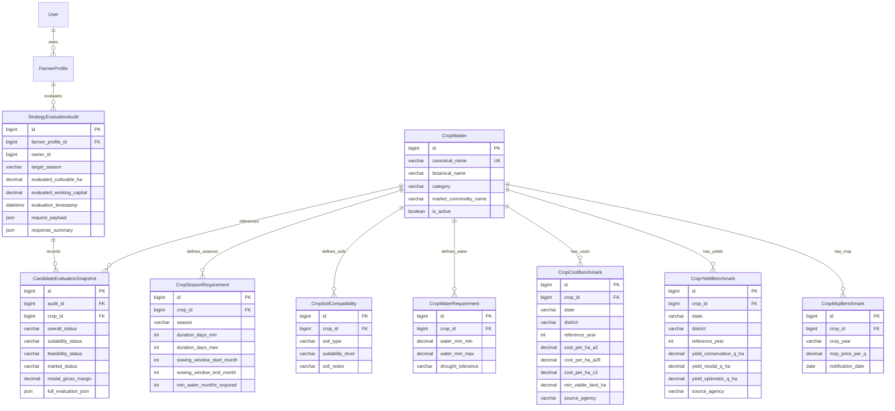

# Strategy Engine Domain Model & Data Architecture

**Platform:** AI Farm Strategy & Decision Engine  
**Document:** Strategy Engine Domain Model Specification  
**Phase:** 3A (Design & Specification)  
**Status:** DRAFT / PENDING APPROVAL  

---

## 1. Architectural Principles & Domain Boundaries

The domain architecture for the **AI Farm Strategy & Decision Engine** follows Domain-Driven Design (DDD) principles:
1. **Separation of Master Reference vs Contextual Data:** Master agronomic envelopes (crop soil tolerances, temperature thresholds, growth duration) and economic benchmarks (costs, yields, MSP) exist as canonical reference data independent of any specific farmer.
2. **Reuse Without Duplication:** The engine consumes existing core entities (`FarmerProfile` and `MarketPriceRecord`) directly through read interfaces rather than duplicating or snapshotting their mutable columns into redundant tables.
3. **Immutability of Strategy Evaluations:** A strategy evaluation execution is a deterministic calculation that produces an immutable evaluation result. If persisted (for history/auditing), it is treated as a historical snapshot tied to the input parameters at that moment in time.
4. **Three-Dimensional Separation:** Biological suitability, financial feasibility, and market attractiveness are modelled as three independent sub-assessments on every candidate crop evaluation, avoiding single-score conflation.
5. **No Phantom Precision:** Economic projections are modelled with explicit uncertainty boundaries (three-point estimation: conservative, modal, optimistic) rather than single-point forecasts.

---

## 2. Existing Domain Model Inventory & Reuse

The strategy engine directly consumes the existing verified entity graph:

```
┌─────────────────────────────────┐
│          FarmerProfile          │
├─────────────────────────────────┤
│ + id: Long                      │
│ + owner: User                   │
│ + primaryState: String          │
│ + primaryDistrict: String       │
│ + totalLandHectares: BigDecimal │
│ + cultivableHectares: BigDecimal│
│ + soilType: SoilType (enum)     │
│ + irrigationSource: Irrigation..│
│ + waterAvailabilityMonths: Int  │
│ + workingCapitalInr: BigDecimal │
│ + riskTolerance: RiskTolerance  │
│ + latitude / longitude: BigDec  │
└─────────────────────────────────┘
                 ▲
                 │ (evaluates constraints of)
                 │
┌────────────────┴────────────────┐             ┌──────────────────────────────────┐
│    StrategyEvaluationRequest    │────────────▶│        MarketPriceRecord         │
│  (Ephemeral / Input Parameter)  │             ├──────────────────────────────────┤
└─────────────────────────────────┘             │ + id: Long                       │
                 │                              │ + state / district / market: Str │
                 │ (produces)                   │ + commodity: String              │
                 ▼                              │ + arrivalDate: LocalDate         │
┌─────────────────────────────────┐             │ + minPrice / maxPrice: BigDecimal│
│    StrategyEvaluationResult     │             │ + modalPrice: BigDecimal         │
│  (Value Object / Audit Entity)  │             │ + priceUnit / currency: String   │
└─────────────────────────────────┘             │ + deduplicationKey: String (hash)│
                                                └──────────────────────────────────┘
```

### Profile Attributes Consumed as Constraints
- **`cultivableHectares` (DECIMAL):** Primary upper bound on total planted land area.
- **`soilType` (Enum):** Hard-filter and suitability grading input against `CropSoilCompatibility`.
- **`irrigationSource` (Enum):** Factor in drought vulnerability and water delivery reliability.
- **`waterAvailabilityMonths` (Integer 0–12):** Hard-filter against `CropSeasonRequirement.durationDaysMax`.
- **`workingCapitalInr` (DECIMAL):** Hard-filter and parcel scaling constraint against cultivation costs.
- **`riskTolerance` (Enum: `LOW`, `MEDIUM`, `HIGH`):** Weighting filter for crops with high price volatility or high capital intensity.
- **`primaryState` & `primaryDistrict`:** Geographic filter for local mandi prices, state yields, and agro-climatic zones.

### Market Attributes Consumed as Evidence
- **`modalPrice` (DECIMAL):** Benchmark wholesale price for modal revenue estimation.
- **`minPrice` / `maxPrice` (DECIMAL):** Spread indicators for conservative/optimistic revenue bounds and volatility risk.
- **`arrivalDate` (LocalDate):** Used to compute freshness status (`FRESH` $\le 7$ days, `STALE` $> 7$ days).

---

## 3. New Entities & Value Objects Specification

The strategy domain introduces three subdomains:
1. **Agronomic Reference Subdomain** (Static/configurable agronomic knowledge)
2. **Economic Reference Subdomain** (Statutory and statistical benchmarks)
3. **Strategy Decision Subdomain** (Evaluation requests, results, and explainability models)

---

### 3.1. Agronomic Reference Subdomain

#### `CropMaster` (Entity)
Represents a botanical and commercial crop definition.
- `id`: `Long` (Primary Key)
- `canonicalName`: `String` (Unique, e.g. "Wheat", "Soybean", "Paddy", "Cotton", "Chickpea")
- `botanicalName`: `String` (e.g. "Triticum aestivum")
- `category`: `CropCategory` (Enum: `CEREAL`, `PULSE`, `OILSEED`, `COMMERCIAL`, `HORTICULTURE`, `FODDER`)
- `marketCommodityName`: `String` (Canonical link string matching AGMARKNET commodity naming)
- `description`: `String` (General agronomic description)
- `isActive`: `Boolean`

#### `CropSeasonRequirement` (Entity)
Defines the seasonal growth envelope and duration for a crop.
- `id`: `Long` (Primary Key)
- `crop`: `CropMaster` (Foreign Key)
- `season`: `GrowingSeason` (Enum: `KHARIF`, `RABI`, `ZAID`, `PERENNIAL`)
- `durationDaysMin`: `Integer` (e.g. 110 days)
- `durationDaysMax`: `Integer` (e.g. 140 days)
- `sowingWindowStartMonth`: `Integer` (1–12)
- `sowingWindowEndMonth`: `Integer` (1–12)
- `harvestWindowStartMonth`: `Integer` (1–12)
- `harvestWindowEndMonth`: `Integer` (1–12)
- `minimumWaterMonthsRequired`: `Integer` (Converted minimum water access duration, e.g. 4 months)

#### `CropSoilCompatibility` (Entity)
Defines compatibility between a crop and specific soil classifications.
- `id`: `Long` (Primary Key)
- `crop`: `CropMaster` (Foreign Key)
- `soilType`: `SoilType` (Enum: `ALLUVIAL`, `BLACK`, `RED`, `LATERITE`, `SANDY`, `LOAMY`, `CLAYEY`, `OTHER`)
- `suitabilityLevel`: `SoilSuitability` (Enum: `HIGHLY_SUITABLE`, `MODERATELY_SUITABLE`, `MARGINAL`, `INCOMPATIBLE`, `UNKNOWN`)
- `soilNotes`: `String` (e.g. "Requires well-drained loamy soil; sensitive to waterlogging")

#### `CropWaterRequirement` (Entity)
Specifies absolute water depth and irrigation constraints.
- `id`: `Long` (Primary Key)
- `crop`: `CropMaster` (Foreign Key)
- `waterRequirementMmMin`: `BigDecimal` (Minimum cumulative water in mm, e.g. 450.00)
- `waterRequirementMmMax`: `BigDecimal` (Maximum cumulative water in mm, e.g. 650.00)
- `criticalGrowthStages`: `String` (e.g. "Crown root initiation, Tillering, Flowering, Grain filling")
- `droughtTolerance`: `RiskLevel` (Enum: `LOW`, `MEDIUM`, `HIGH`)
- `waterloggingTolerance`: `RiskLevel` (Enum: `LOW`, `MEDIUM`, `HIGH`)

#### `CropClimateRequirement` (Entity / Value Object)
Specifies temperature and rainfall tolerance boundaries.
- `tempMinC`: `BigDecimal` (Absolute lower growth threshold)
- `tempOptMinC`: `BigDecimal` (Optimal minimum temperature)
- `tempOptMaxC`: `BigDecimal` (Optimal maximum temperature)
- `tempMaxC`: `BigDecimal` (Absolute upper growth threshold)
- `heatStressThresholdC`: `BigDecimal` (Temperature causing yield reduction)
- `frostSensitive`: `Boolean`

---

### 3.2. Economic Reference Subdomain

#### `CropCostBenchmark` (Entity)
Cost of cultivation operational expenditure (OpEx) benchmarks.
- `id`: `Long` (Primary Key)
- `crop`: `CropMaster` (Foreign Key)
- `state`: `String` (Nullable — state-specific or national benchmark)
- `district`: `String` (Nullable — district-specific benchmark)
- `referenceYear`: `Integer` (e.g. 2024)
- `costPerHectareA2`: `BigDecimal` (Paid-out costs: seeds, fertilizers, pesticides, hired labor, machinery, irrigation)
- `costPerHectareA2FL`: `BigDecimal` (Paid-out costs + imputed value of family labor)
- `costPerHectareC2`: `BigDecimal` (Comprehensive cost: including land rent and interest on capital)
- `minimumViableLandHectares`: `BigDecimal` (e.g. 0.2000 ha)
- `isConfigurableDefault`: `Boolean`
- `sourceAgency`: `String` (e.g. "CACP Comprehensive Scheme", "State Agricultural University")

#### `CropYieldBenchmark` (Entity)
Statistical historical yield benchmarks in quintals per hectare.
- `id`: `Long` (Primary Key)
- `crop`: `CropMaster` (Foreign Key)
- `state`: `String` (State-level classification)
- `district`: `String` (Nullable district classification)
- `referenceYear`: `Integer`
- `yieldConservativeQuintalPerHa`: `BigDecimal` (e.g. 20th percentile yield, low-input/drought)
- `yieldModalQuintalPerHa`: `BigDecimal` (Average/median expected yield)
- `yieldOptimisticQuintalPerHa`: `BigDecimal` (e.g. 80th percentile yield, optimal management)
- `sourceAgency`: `String` (e.g. "DES Agricultural Statistics at a Glance")

#### `CropMspBenchmark` (Entity)
Statutory Minimum Support Price notified by the Government of India.
- `id`: `Long` (Primary Key)
- `crop`: `CropMaster` (Foreign Key)
- `cropYear`: `String` (e.g. "2025-26")
- `mspPricePerQuintal`: `BigDecimal` (e.g. 2425.00)
- `notificationDate`: `LocalDate`
- `sourceAgency`: `String` ("Ministry of Agriculture & Farmers Welfare")

---

### 3.3. Strategy Decision Subdomain (Results & Explanations)

#### `StrategyEvaluationRequest` (Value Object / DTO)
Input parameters specifying the scope of a strategy evaluation.
- `targetSeason`: `GrowingSeason` (Required: `KHARIF`, `RABI`, or `ZAID`)
- `planningYear`: `Integer` (Optional, defaults to current year)
- `cultivableHectaresOverride`: `BigDecimal` (Optional speculative land override)
- `workingCapitalOverride`: `BigDecimal` (Optional speculative budget override)
- `candidateCropIds`: `List<Long>` (Optional candidate filter; evaluates all active season crops if omitted)

#### `CandidateCropEvaluation` (Value Object)
Complete multi-dimensional evaluation for a single candidate crop.
- `cropId`: `Long`
- `cropName`: `String`
- `overallStatus`: `CandidateStatus` (Enum: `SUITABLE_AND_FEASIBLE`, `CONDITIONALLY_FEASIBLE`, `INFEASIBLE_EXCLUDED`)
- `agronomicSuitability`: `AgronomicSuitabilityAssessment`
- `financialFeasibility`: `FinancialFeasibilityAssessment`
- `marketAttractiveness`: `MarketAttractivenessAssessment`
- `economicProjection`: `EconomicProjection`
- `risks`: `List<StrategyRiskFactor>`
- `explanations`: `List<String>`
- `dataQualityWarnings`: `List<DataQualityWarning>`

#### `AgronomicSuitabilityAssessment` (Value Object)
- `status`: `SuitabilityLevel` (`HIGHLY_SUITABLE`, `MODERATELY_SUITABLE`, `MARGINAL`, `INCOMPATIBLE`)
- `soilFit`: `SoilFitEvaluation` (Soil name, compatibility level, specific notes)
- `waterFit`: `WaterFitEvaluation` (Water duration adequacy, deficit/surplus months)
- `seasonFit`: `SeasonFitEvaluation` (Alignment with target planting window)
- `climateFit`: `ClimateFitEvaluation` (Temperature and rainfall envelope evaluation)
- `factorExplanations`: `List<String>`

#### `FinancialFeasibilityAssessment` (Value Object)
- `status`: `FeasibilityStatus` (`FEASIBLE`, `PARTIALLY_FEASIBLE`, `INFEASIBLE`)
- `requiredWorkingCapitalFullParcel`: `BigDecimal` ($\text{CultivableHa} \times \text{CostPerHa}$)
- `availableWorkingCapital`: `BigDecimal`
- `capitalSufficiencyRatio`: `BigDecimal` ($\frac{\text{Available}}{\text{Required}}$)
- `affordableHectares`: `BigDecimal`
- `isLandConstrained`: `Boolean` (True if capital exceeds land requirements)
- `isCapitalConstrained`: `Boolean` (True if capital limits land utilization)
- `riskAlignment`: `RiskAlignmentStatus` (`ALIGNED`, `HIGH_RISK_MISMATCH`, `LOW_RISK_CONSERVATIVE`)
- `explanation`: `String`

#### `MarketAttractivenessAssessment` (Value Object)
- `status`: `MarketStatus` (`FAVORABLE`, `MODERATE`, `UNFAVORABLE`, `NO_DATA`)
- `priceUsed`: `BigDecimal` (INR per quintal)
- `priceType`: `PriceType` (`LOCAL_MANDI_MODAL`, `DISTRICT_AVERAGE`, `STATE_AVERAGE`, `MSP_FLOOR`, `BENCHMARK`)
- `mandiName`: `String` (Nullable if state/benchmark)
- `latestArrivalDate`: `LocalDate` (Nullable if benchmark)
- `daysOld`: `Integer`
- `freshnessStatus`: `FreshnessStatus` (`FRESH`, `STALE`, `NO_DATA`)
- `mspPrice`: `BigDecimal` (Nullable if no MSP)
- `priceSpreadRatio`: `BigDecimal` ($\frac{\text{Max} - \text{Min}}{\text{Modal}}$)
- `explanation`: `String`

#### `EconomicProjection` (Value Object)
Three-point scenario model of revenue and margins.
- `allocatedHectares`: `BigDecimal`
- `totalEstimatedCostInr`: `BigDecimal`
- `yieldRangeQuintalPerHa`: `ScenarioRange` (conservative, modal, optimistic)
- `totalProductionQuintals`: `ScenarioRange` (conservative, modal, optimistic)
- `grossWholesaleRevenueInr`: `ScenarioRange` (conservative, modal, optimistic)
- `grossMarginInr`: `ScenarioRange` (conservative, modal, optimistic)
- `grossMarginPerHectareInr`: `ScenarioRange` (conservative, modal, optimistic)
- `statutoryDisclaimer`: `String`
- `excludedCostItems`: `List<String>` (e.g. "Post-harvest transport to mandi", "Mandi market user cess (1-2%)", "Storage & bagging costs", "Land lease / opportunity cost of land")

#### `StrategyRiskFactor` (Value Object)
- `category`: `RiskCategory` (`AGRONOMIC`, `WEATHER`, `MARKET`, `FINANCIAL`)
- `severity`: `RiskSeverity` (`LOW`, `MEDIUM`, `HIGH`, `CRITICAL`)
- `title`: `String`
- `description`: `String`
- `mitigationAdvice`: `String`

#### `DataQualityWarning` (Value Object)
- `code`: `String` (e.g. `STALE_MARKET_PRICE`, `UNREPORTED_SOIL_TYPE`, `BENCHMARK_COST_SUBSTITUTION`)
- `field`: `String`
- `severity`: `WarningSeverity` (`INFO`, `WARNING`, `CRITICAL`)
- `message`: `String`
- `provenanceNotice`: `String`

---

## 4. Entity Relationship Diagram (ERD)



---

## 5. Missing Data Inventory & Source Provenance

The table below catalogs what data is currently available in the application vs what is required for Phase 3 and must be sourced or collected:

| Domain Field | Current Status in Codebase | Source / Provenance Strategy | Fallback Behavior When Missing |
|---|---|---|---|
| **Farmer Land Scale** | ✅ Available (`cultivableHectares`, `totalLandHectares`) | User reported in `FarmerProfile`. | Reject evaluation with `422 Unprocessable Entity` if $\le 0$. |
| **Farmer Soil Type** | ✅ Available (`soilType` enum) | User reported in `FarmerProfile`. | Degrade to `MODERATELY_SUITABLE` across broad soil classes; attach `UNREPORTED_SOIL_TYPE` warning. |
| **Farmer Water Access** | ✅ Available (`waterAvailabilityMonths`, `irrigationSource`) | User reported in `FarmerProfile`. | Default to rainfed profile (0 months stored = treat as 3 months monsoon duration); attach warning. |
| **Farmer Working Capital** | ✅ Available (`workingCapitalInr`) | User reported in `FarmerProfile`. | Skip financial disqualification; calculate per-hectare requirements; attach `UNREPORTED_WORKING_CAPITAL` warning. |
| **Farmer Location** | ✅ Available (`primaryState`, `primaryDistrict`) | User reported in `FarmerProfile`. | Reject evaluation with `422 Unprocessable Entity`. |
| **Local Mandi Prices** | ✅ Available (`MarketPriceRecord`) | Daily ingestion from AGMARKNET (`data.gov.in`). | Fallback hierarchy: State modal $\to$ statutory MSP floor $\to$ national benchmark. Attach freshness/fallback warning. |
| **Crop Agronomic Catalog** | ❌ Missing | Seed database via Stage 1 migration from ICAR Package of Practices. | Cannot evaluate; catalog must be pre-populated. |
| **Cost of Cultivation** | ❌ Missing | Seed database via Stage 3 migration from CACP Comprehensive Scheme. | Fallback to national default cost benchmark with prominent `BENCHMARK_COST_SUBSTITUTION` warning. |
| **District Crop Yields** | ❌ Missing | Seed database via Stage 3 migration from DES Agricultural Statistics. | Fallback to state modal yield with `BENCHMARK_YIELD_SUBSTITUTION` warning. |
| **Minimum Support Price** | ❌ Missing | Seed database via Stage 3 migration from DAC&FW notifications. | Null MSP floor; rely on market observations or benchmarks. |
