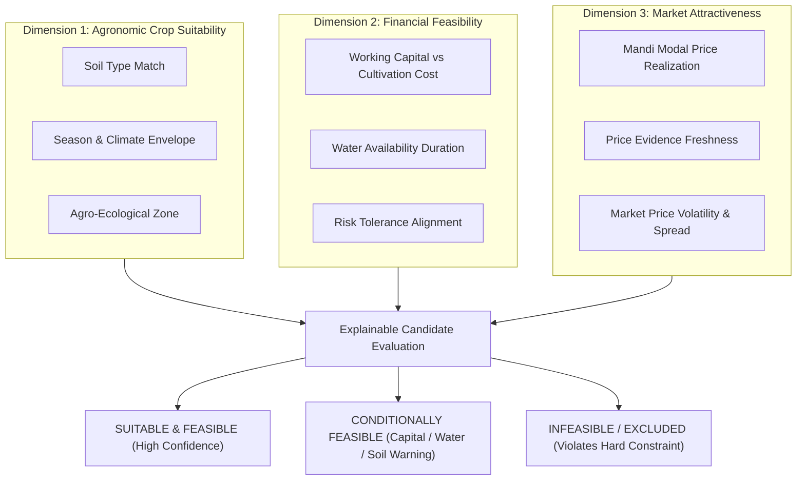

# Strategy Engine Requirements & Phased Implementation Plan

**Platform:** AI Farm Strategy & Decision Engine  
**Document:** Strategy Engine Requirements Specification  
**Phase:** 3A (Design & Specification)  
**Status:** DRAFT / PENDING APPROVAL  

---

## 1. Executive Summary & Problem Context

The core mission of the **AI Farm Strategy & Decision Engine** is to transition agricultural advice from reactive, ad-hoc guidance to proactive, structured, and explainable farm planning:
> *"From 'What should I grow?' to 'Where and when should I sell?'"*

Smallholder and commercial farmers face high uncertainty across three interconnected dimensions:
1. **Biological & Environmental:** Will this crop physically grow and thrive given my specific soil, water access, and local climate envelope?
2. **Financial & Operational:** Can I afford the upfront working capital required to cultivate this crop across my cultivable land without running out of cash mid-season?
3. **Commercial & Market:** What wholesale price evidence exists in my local mandis, how fresh is that evidence, and what are the realistic revenue and margin expectations after accounting for production costs?

Most existing digital agriculture applications collapse these multi-dimensional factors into an opaque, single numerical score (e.g. *"94% match"*), concealing trade-offs, masking missing data, and creating an illusion of financial certainty. 

**Phase 3A establishes the design for a deterministic, explainable, and multi-dimensional strategy engine.** The engine separates agronomic suitability, financial feasibility, and market attractiveness into distinct evaluations, quantifies economic uncertainty using three-point estimations (conservative, modal, optimistic), highlights data gaps, and provides transparent audit trails for every recommendation and disqualification.

---

## 2. Current Implementation Baseline (Source of Truth)

The design builds strictly on the verified codebase across Phases 1, 2A, 2B.1, and 2B.2. The strategy engine will consume existing entities and services without re-architecting baseline components:

| Module | Implemented Source of Truth | Strategy Engine Role |
|---|---|---|
| **User & Auth** | Spring Security JWT stateless authentication; user ownership enforcement (`principal.id == {userId}`). | Secures strategy endpoints; strictly isolates farmer decision data per tenant. |
| **Farmer Profile (V1–V4)** | `FarmerProfile` entity with: `fullName`, `phoneNumber`, `primaryState`, `primaryDistrict`, `totalLandHectares`, `cultivableHectares`, `yearsOfExperience`, `soilType` (enum), `irrigationSource` (enum), `waterAvailabilityMonths` (0–12), `workingCapitalInr` (DECIMAL), `riskTolerance` (enum), `latitude`, `longitude`. | Supplies core farm constraints: soil, water duration, available budget, cultivable scale, geographic district/state. |
| **Weather Service (2B.1)** | `OpenMeteoWeatherService`, `FarmerWeatherResponse`, `DailyForecastDto`: coordinates/district fallback, 7-day temperature, rainfall, wind, evapotranspiration. | Provides short-term weather risk indicators and climate context for sowing/harvest windows. |
| **Market Mandi Ingestion (2B.2)** | `MarketPriceRecord` entity, `MarketPriceRecordRepository`, `DataGovInMarketService`: V5 migration table with `minPrice`, `maxPrice`, `modalPrice`, `arrivalDate`, `priceUnit` (`INR_PER_QUINTAL`), 64-char SHA-256 deduplication key, deterministic ordering, 7-day freshness check (`FRESH`, `STALE`, `NO_DATA`). | Supplies local mandi price evidence, price spread, and freshness indicators for candidate crops. |
| **Frontend UI** | React + TypeScript + Tailwind CSS: `FarmerProfilePage`, `FarmerWeatherSection`, `FarmerMarketPricesSection`. | Will host the interactive strategy evaluation dashboard, comparative crop cards, and explanation modals. |

> [!IMPORTANT]
> **Implementation Baseline Boundary:**  
> The current system stores farmer profiles, retrieves Open-Meteo forecasts, and persists AGMARKNET mandi price records. It **does not yet have**:
> 1. A master crop catalog with agronomic thresholds and water/soil requirements.
> 2. Official benchmark cost of cultivation or yield datasets.
> 3. Strategy evaluation algorithms, strategy entities, or strategy REST endpoints.
>
> Phase 3A specifies these missing structures without implementing them.

---

## 3. Defining the Decision Problem

The strategy engine must answer six specific questions for any evaluated farm:

```
                  ┌────────────────────────────────────────────────────────┐
                  │                 FARMER DECISION PROBLEM                │
                  └───────────────────────────┬────────────────────────────┘
                                              │
         ┌────────────────────────────────────┼────────────────────────────────────┐
         │                                    │                                    │
┌────────┴─────────┐                 ┌────────┴─────────┐                 ┌────────┴─────────┐
│   QUESTION 1 & 2 │                 │   QUESTION 3 & 4 │                 │   QUESTION 5 & 6 │
│  Suitability &   │                 │   Weather &      │                 │  Economics &     │
│   Feasibility    │                 │  Market Evidence │                 │   Information    │
└──────────────────┘                 └──────────────────┘                 └──────────────────┘
```

### The 6 Core Decision Questions

#### Question 1: Which crops are suitable for this farmer's land and available resources?
- Evaluates biological and agronomic compatibility.
- Matches `FarmerProfile.soilType` against crop soil preferences.
- Matches agro-climatic region (`primaryState`, `primaryDistrict`) against crop agro-climatic zones.
- Matches planting season (Kharif, Rabi, Zaid) against target evaluation period.

#### Question 2: Which crops are feasible within the farmer's working capital and water constraints?
- Evaluates operational and financial constraints.
- Compares `FarmerProfile.waterAvailabilityMonths` against crop growth duration and peak water demand periods.
- Compares `FarmerProfile.workingCapitalInr` against the minimum capital required to cultivate a viable plot of the crop.
- Identifies the maximum affordable land allocation for each candidate crop.

#### Question 3: What weather and seasonal risks affect each candidate crop?
- Identifies acute short-term weather risks (heat stress, excessive rainfall during flowering/harvest, dry spells) from current Open-Meteo forecasts.
- Evaluates seasonal drought sensitivity for rainfed vs irrigated irrigation systems (`FarmerProfile.irrigationSource`).

#### Question 4: What recent market evidence is available for each candidate?
- Queries locally persisted `MarketPriceRecord` entries for the farmer's `primaryDistrict` and `primaryState`.
- Evaluates market data freshness against the 7-day threshold (`FRESH`, `STALE`, or `NO_DATA`).
- Assesses price volatility and market liquidity via min-max price spreads.

#### Question 5: What are the estimated costs, potential revenue, margins, and uncertainties?
- Computes estimated total cultivation cost ($INR$) for the cultivable area.
- Computes three-point gross wholesale revenue estimates ($INR$) based on conservative, modal, and optimistic yield and price scenarios.
- Computes estimated gross margin ranges ($INR$).
- Separates wholesale revenue from net farm income and explicitly enumerates excluded costs (e.g. mandi cess, transport, storage, land rent).

#### Question 6: What additional information is needed before making a definitive recommendation?
- Detects missing profile fields (e.g. unknown soil type, missing cultivable hectares, missing working capital).
- Flags unverified benchmark assumptions (e.g. missing local mandi data, defaulting to state-level or national benchmarks).
- Prompts the farmer for required inputs rather than inventing synthetic default values.

---

### The Three Independent Decision Dimensions

The engine strictly rejects monolithic scoring. A crop is evaluated independently across three distinct dimensions:



| Evaluation Dimension | Core Concern | Primary Criteria | Possible Outputs |
|---|---|---|---|
| **1. Agronomic Suitability** | Can it grow here? | Soil compatibility, temperature range, seasonal planting window, agro-climatic zone. | `HIGHLY_SUITABLE`, `MODERATELY_SUITABLE`, `MARGINAL`, `INCOMPATIBLE` (Disqualified) |
| **2. Financial Feasibility** | Can the farmer afford it? | Cultivation cost per hectare vs `workingCapitalInr`, water duration months vs crop duration, risk profile. | `FEASIBLE`, `PARTIALLY_FEASIBLE` (Capital constrained to partial parcel), `INFEASIBLE` (Disqualified) |
| **3. Market Attractiveness** | Is it economically rewarding? | Recent mandi modal price, data freshness (days old), historical volatility, MSP price floor protection. | `FAVORABLE`, `MODERATE`, `UNFAVORABLE`, `NO_DATA` |

---

## 4. Functional Requirements

### FR-1: Profile & Environmental Context Ingestion
- **FR-1.1:** The engine must retrieve the authenticated farmer's `FarmerProfile` using `userId`, enforcing ownership.
- **FR-1.2:** If `cultivableHectares` or `totalLandHectares` is missing or $\le 0$, the engine must reject evaluation with an explainable `422 Unprocessable Entity` or prompt for input.
- **FR-1.3:** If `primaryState` or `primaryDistrict` is missing, the engine must return a structured error requesting location data.
- **FR-1.4:** The engine must accept optional evaluation parameters: target season (`KHARIF`, `RABI`, `ZAID`), planning year, custom land allocation override, and custom working capital override.

### FR-2: Agronomic Hard-Filter & Disqualification
- **FR-2.1:** The engine must disqualify crops whose soil requirement is incompatible with `FarmerProfile.soilType` (e.g. waterlogged clay for crops requiring loose sandy loam).
- **FR-2.2:** The engine must disqualify crops whose growing cycle duration exceeds `FarmerProfile.waterAvailabilityMonths` when irrigation is non-perennial.
- **FR-2.3:** The engine must disqualify crops that do not align with the evaluated target season.
- **FR-2.4:** Disqualified crops must not be silently omitted; they must be returned in an `excludedCrops` section with specific, human-readable disqualification codes and explanations.

### FR-3: Suitability Dimension Assessment
- **FR-3.1:** Each candidate crop must be evaluated for soil fit (`HIGH`, `MODERATE`, `MARGINAL`).
- **FR-3.2:** Water requirements must be checked against `FarmerProfile.irrigationSource` and `waterAvailabilityMonths`.
- **FR-3.3:** Climate and weather boundaries (temperature min/max, heat stress tolerance) must be evaluated against localized climate normals.

### FR-4: Financial Budgeting & Capital Constraints
- **FR-4.1:** The engine must calculate the total cost of cultivation across the farmer's cultivable land: $\text{TotalCost} = \text{CultivableHectares} \times \text{CostPerHectare}$.
- **FR-4.2:** If $\text{workingCapitalInr} \ge \text{TotalCost}$, the crop is marked as `FEASIBLE` for the full parcel.
- **FR-4.3:** If $0 < \text{workingCapitalInr} < \text{TotalCost}$, the engine must calculate the maximum affordable area: $\text{AffordableHectares} = \frac{\text{workingCapitalInr}}{\text{CostPerHectare}}$. If $\text{AffordableHectares} \ge \text{MinimumViablePlotSize}$, the crop is marked as `PARTIALLY_FEASIBLE` with a capital warning.
- **FR-4.4:** If $\text{workingCapitalInr} < \text{MinimumViableCost}$, the crop is marked as `INFEASIBLE`.
- **FR-4.5:** If `workingCapitalInr` is null (unreported), the engine must evaluate suitability without financial filtering, attaching an `UNREPORTED_WORKING_CAPITAL` warning.

### FR-5: Market Price Evidence & Freshness Integration
- **FR-5.1:** The engine must query locally persisted `MarketPriceRecord` entities for matching commodity, district, and state.
- **FR-5.2:** If records exist within the freshness threshold ($\le 7$ days), the latest modal price must be used as the primary market price.
- **FR-5.3:** If local records are stale ($> 7$ days), the engine must mark price evidence as `STALE`, attach a freshness warning, and display days elapsed.
- **FR-5.4:** If no local records exist (`NO_DATA`), the engine must check for:
  1. District-level fallback (other mandis in same district).
  2. State-level modal average.
  3. Minimum Support Price (MSP) statutory floor.
  4. Configurable national benchmark.
- **FR-5.5:** The engine must never manufacture synthetic prices or hide that a price is an unverified benchmark.

### FR-6: Economic Projection & 3-Point Uncertainty Estimation
- **FR-6.1:** All financial projections must be expressed as three-point estimates:
  - **Conservative:** Lower-bound yield (e.g. 20th percentile) $\times$ lower-bound price (e.g. minimum mandi price or MSP floor).
  - **Modal:** Expected modal yield $\times$ latest modal mandi price.
  - **Optimistic:** Upper-bound yield (e.g. 80th percentile) $\times$ upper-bound price (e.g. maximum mandi price).
- **FR-6.2:** Revenue and gross margins must be calculated separately:
  $$\text{GrossWholesaleRevenue} = \text{Area} \times \text{Yield} \times \text{Price}$$
  $$\text{EstimatedGrossMargin} = \text{GrossWholesaleRevenue} - \text{TotalCultivationCost}$$
- **FR-6.3:** The engine must explicitly state that figures represent **gross wholesale realization**, not net farmer take-home profit, and must list standard post-harvest deductions.

### FR-7: Risk Identification & Mitigations
- **FR-7.1:** The engine must identify discrete risk factors across four categories: `AGRONOMIC`, `WEATHER`, `MARKET`, and `FINANCIAL`.
- **FR-7.2:** Each identified risk must include a severity rating (`LOW`, `MEDIUM`, `HIGH`, `CRITICAL`), a clear description, and actionable mitigation advice.

### FR-8: Explainability & Audit Trail
- **FR-8.1:** Every recommendation, condition, and exclusion must include an evidence-based explanation string.
- **FR-8.2:** Strategy evaluations must be assigned a unique evaluation ID and timestamp, allowing deterministic reproduction.

### FR-9: Data Quality, Attribution, & Disclaimers
- **FR-9.1:** All responses must include data quality metadata identifying which parameters were verified from official sources vs user-reported vs benchmark defaults.
- **FR-9.2:** Responses incorporating market prices or weather data must include GODL India and Open-Meteo licensing and attribution.
- **FR-9.3:** Every evaluation output must include a prominent advisory disclaimer: *"Estimates are indicative economic models and do not constitute financial, agronomic, or yield guarantees."*

---

## 5. Non-Functional Requirements

| Requirement | Metric / Specification | Justification |
|---|---|---|
| **Determinism** | Identical inputs must yield bitwise identical output structures and numbers. | Essential for scientific validity, testability, and farmer trust. |
| **Explainability** | 100% of recommendations, conditional flags, and rejections must contain plain-language explanations. | Opaque scores cannot help farmers understand trade-offs or take mitigative action. |
| **Response Latency** | $\le 250\text{ ms}$ for a complete strategy evaluation of 15 candidate crops. | Fast UI rendering without blocking user interactions; evaluation operates on local database tables without external HTTP roundtrips during request execution. |
| **Stateless Evaluation** | Strategy engine evaluation must be idempotent and side-effect free. | Allows speculative user overrides ("What if I had ₹50,000 more capital?") without corrupting the stored profile. |
| **Security & Privacy** | Strict tenant ownership check (`principal.id == {userId}`). Return `403 Forbidden` on mismatch. | Farmer landholding, financial budget, and crop plans are sensitive private business data. |
| **Numerical Precision** | All monetary amounts in `DECIMAL(14, 2)` / `BigDecimal`; land areas in `DECIMAL(10, 4)`. | Floating-point rounding errors are unacceptable in financial projections. |

---

## 6. Phased Implementation & Verification Plan

The strategy engine will be delivered in small, reviewable stages. Each stage has strict acceptance criteria and cannot proceed without approval:

```mermaid
gantt
    title Strategy Engine Phased Roadmap
    dateFormat  X
    axisFormat  Stage %s
    section Core Strategy
    Stage 1: Agronomic Catalog & Reference Foundation       :0, 1
    Stage 2: Deterministic Suitability Evaluator (Agronomic):1, 2
    Stage 3: Financial Feasibility & Budgeting Engine       :2, 3
    Stage 4: Market Integration & Economic 3-Point Projection:3, 4
    Stage 5: Secured Strategy REST API & Audit Persistence   :4, 5
    Stage 6: Strategy Frontend UI & Explainability Dashboard :5, 6
```

### Stage 1: Agronomic Catalog & Reference Foundation
- **Objective:** Establish the database schema and domain models for crop master definitions, growing seasons, soil compatibility matrices, and water requirements.
- **Key Deliverables:**
  - Flyway migration V6 for `crop_master`, `crop_season_requirements`, `crop_soil_compatibility`, `crop_water_requirements`.
  - Domain entities, repositories, and initial reference dataset for common Indian crops across major agro-climatic zones (e.g. Wheat, Paddy, Cotton, Soybean, Chickpea, Mustard, Groundnut, Maize).
  - Deterministic integration tests verifying schema constraints, non-null requirements, and query performance.
- **Acceptance Criteria:**
  - Zero hardcoded magic strings in business logic.
  - V6 migration applies cleanly across MySQL and H2 test profiles.
  - 100% test pass rate on crop catalog retrieval and filtering.

### Stage 2: Deterministic Suitability Evaluator (Agronomic Dimension)
- **Objective:** Implement the agronomic matching engine that filters candidate crops against farmer soil, season, and water duration.
- **Key Deliverables:**
  - `CropSuitabilityService` and evaluation domain logic.
  - Hard-constraint rejection filter (soil incompatibility, water availability deficit, off-season).
  - Detailed reason code and human-readable explanation generation for every crop.
  - Comprehensive unit test suite covering valid matches, borderline marginal fits, and all hard rejection paths.
- **Acceptance Criteria:**
  - Disqualified crops are correctly tagged with rejection reasons (e.g. `INCOMPATIBLE_SOIL`, `WATER_DEFICIT`).
  - Missing soil type gracefully degrades to broad compatibility mode with an explicit data quality warning.
  - No synthetic scores; distinct suitability levels (`HIGHLY_SUITABLE`, `MODERATELY_SUITABLE`, `MARGINAL`, `INCOMPATIBLE`).

### Stage 3: Financial Feasibility & Working Capital Budgeting Engine
- **Objective:** Implement the operational budgeting engine that checks working capital, land scale, and risk appetite.
- **Key Deliverables:**
  - Flyway migration V7 for `crop_cost_benchmarks` and `crop_yield_benchmarks` (with source provenance tracking).
  - `CropFinancialFeasibilityService` evaluating capital sufficiency ratio, affordable hectares, and risk tolerance alignment.
  - Unit tests verifying budget allocations: full parcel funding, partial parcel funding with capital warning, and total capital shortfall rejection.
- **Acceptance Criteria:**
  - Correct calculation of affordable land area without floating-point errors (`BigDecimal`).
  - Clear distinction between "agronomically suitable" and "financially affordable".
  - Unreported working capital cleanly bypassed with an explicit `UNREPORTED_WORKING_CAPITAL` warning.

### Stage 4: Market Integration & Economic 3-Point Projection Engine
- **Objective:** Connect the strategy engine to persisted `MarketPriceRecord` data and calculate 3-point economic projections.
- **Key Deliverables:**
  - `CropEconomicProjectionService` querying local mandi prices and falling back to state/MSP/benchmark data.
  - Three-point uncertainty modeling: Conservative, Modal, and Optimistic gross wholesale revenue and gross margin ranges.
  - Freshness evaluation integration ($\le 7$ days = `FRESH`, $> 7$ days = `STALE`, absent = `NO_DATA`).
  - Prominent disclaimer and post-harvest deduction itemization.
- **Acceptance Criteria:**
  - Wholesale revenue explicitly separated from net farm income.
  - Deterministic 3-point outputs; zero guaranteed-profit phrasing.
  - Stale and missing market prices explicitly flagged with provenance metadata.

### Stage 5: Secured Strategy REST API & Audit Persistence
- **Objective:** Expose the strategy evaluation engine via secured Spring Boot REST endpoints with full audit logging.
- **Key Deliverables:**
  - `POST /api/v1/users/{userId}/farmer-profile/strategy/evaluate` endpoint.
  - Flyway migration V8 for `strategy_evaluation_audits` to preserve run snapshots for reproducible farmer history.
  - Input validation, ownership enforcement (`validateOwnership`), and standard RFC 7807 error formatting.
  - MockMvc controller tests and end-to-end integration tests.
- **Acceptance Criteria:**
  - Unauthenticated requests return `401 Unauthorized`; cross-user access returns `403 Forbidden`.
  - Incomplete profiles missing cultivable land or location return `422 Unprocessable Entity`.
  - Audit record saved with exact input parameters and generated response.

### Stage 6: Strategy Frontend UI & Explainability Dashboard
- **Objective:** Build an accessible, explainable strategy evaluation interface in React/TypeScript.
- **Key Deliverables:**
  - `FarmerStrategyPage` and modular strategy components (`CandidateCropCard`, `SuitabilityBadge`, `EconomicProjectionRange`, `ExclusionModal`).
  - Interactive controls allowing farmers to test "What-If" scenarios (changing budget, adjusting target season).
  - Clear visualization of the 3-point economic uncertainty ranges (conservative/modal/optimistic).
  - Full mobile-responsive layout and accessibility compliance.
- **Acceptance Criteria:**
  - Zero unhandled exceptions or console errors.
  - All warnings, disclaimers, and data attributions clearly visible.
  - End-to-end verification across frontend and backend.

---

## 7. External Data Sources, Provenance, & Integration Limitations

The table below provides a comprehensive audit of all external datasets required for the end-to-end strategy engine, explicitly distinguishing verified existing integrations from proposed future integrations:

### 7.1. Verified Existing Integrations vs Proposed Future Integrations

```
┌────────────────────────────────────────────────────────────────────────┐
│                   EXTERNAL INTEGRATION ARCHITECTURE                    │
└───────────────────────────────────┬────────────────────────────────────┘
                                    │
         ┌──────────────────────────┴──────────────────────────┐
         │                                                     │
┌────────┴──────────────┐                             ┌────────┴──────────────┐
│  VERIFIED EXISTING    │                             │    PROPOSED FUTURE    │
│  INTEGRATIONS         │                             │    INTEGRATIONS       │
│  (Phases 2B.1 & 2B.2) │                             │    (Phase 3 Stages)   │
└────────┬──────────────┘                             └────────┬──────────────┘
         │                                                     │
         ├─ Open-Meteo Weather API                             ├─ ICAR Package of Practices
         └─ data.gov.in AGMARKNET Mandi Ingestion              ├─ CACP Cost of Cultivation Scheme
                                                               ├─ DES Agricultural Statistics (Yields)
                                                               └─ DAC&FW Minimum Support Prices (MSP)
```

| Dataset Name | Integration Status | Official Publishing Agency | Required Fields | Licensing & Attribution | Geographic & Temporal Coverage | Refresh Cadence | Known Gaps & Fallback Failure Behavior |
|---|---|---|---|---|---|---|---|
| **Daily Mandi Prices (AGMARKNET)** | **Verified Existing (Phase 2B.2)** | Directorate of Marketing & Inspection (DMI) via `data.gov.in` (Resource: `9ef84268-d588-465a-a308-a864a43d0070`) | `state`, `district`, `market`, `commodity`, `variety`, `grade`, `arrival_date`, `min_price`, `max_price`, `modal_price` | Government Open Data License - India (GODL). Requires explicit user-facing attribution link. | National coverage across ~3,000 regulated APMC mandis. Daily arrival dates. | Daily. | Gaps: Incomplete reporting by smaller sub-mandis; spelling variations in commodity/variety names; missing modal prices (raw nulls). Fallback: Mark as `STALE` if $> 7$ days or `NO_DATA` if absent. Fall back to state average or MSP floor. |
| **Meteorological Forecast & History** | **Verified Existing (Phase 2B.1)** | Open-Meteo GmbH (`api.open-meteo.com`) | `temperature_2m_max`, `temperature_2m_min`, `precipitation_sum`, `precipitation_probability_max`, `wind_speed_10m_max`, `et0_fao_evapotranspiration` | Creative Commons Attribution 4.0 (CC BY 4.0). Requires text: "Weather data by Open-Meteo.com" linking to `open-meteo.com`. | Global 11km–1km grid. 7-day daily forecast and historical reanalysis. | Hourly updates. | Gaps: API rate limits (HTTP 429 on free tier); network timeouts. Centroid approximation when exact farm coordinates are unrecorded. Fallback: District centroid geocoding; 502/504 error handling with wire-mocked test parity. |
| **Crop Agronomic Envelopes** | **Proposed (Phase 3 Stage 1)** | Indian Council of Agricultural Research (ICAR) & State Agricultural Universities (SAUs) | `canonical_name`, `botanical_name`, `category`, `duration_days_min/max`, `soil_tolerances`, `water_mm_min/max`, `temp_thresholds`, `sowing_windows` | Public Domain / ICAR Package of Practices publications. | National coverage across 15 Agro-Climatic Zones of India. | Decennial updates / annual cultivar releases. | Gaps: Micro-climatic variation and localized variety tolerances not fully captured in national averages. Fallback: Store baseline national ranges with state-level overrides where documented. |
| **Cost of Cultivation Benchmarks** | **Proposed (Phase 3 Stage 3)** | Commission for Agricultural Costs and Prices (CACP) & Directorate of Economics and Statistics (DES) | `crop_name`, `state`, `cost_a2` (paid-out inputs), `cost_a2_fl` (paid-out + family labor), `cost_c2` (comprehensive cost), `reference_year` | Official Government Reports (CACP Reports on Price Policy). | State-level coverage for 25 major crops across key producing states. | Annual to biennial lag. | Gaps: Historical 1–2 year publishing lag; does not account for intra-district input price inflation (e.g. diesel/fertilizer spikes). Fallback: Base figures on latest published CACP report, scaled by annual CPI-AL (Consumer Price Index for Agricultural Laborers) inflation factor, with explicit `BENCHMARK_COST_SUBSTITUTION` warning. |
| **Historical District Crop Yields** | **Proposed (Phase 3 Stage 3)** | Directorate of Economics and Statistics (DES), Ministry of Agriculture | `state`, `district`, `crop`, `area_hectares`, `production_tonnes`, `yield_kg_per_ha`, `year` | Open Government Data (data.gov.in / APS Agricultural Production Statistics). | District-level historical time series across 1997–2022. | Annual reporting lag. | Gaps: Reporting delays of 12–24 months; missing records for newly bifurcated districts. Fallback: Three-point statistical modeling using 20th percentile (conservative), median (modal), and 80th percentile (optimistic) yields from state-level time series. |
| **Minimum Support Prices (MSP)** | **Proposed (Phase 3 Stage 3)** | Cabinet Committee on Economic Affairs (CCEA) & DAC&FW | `crop_name`, `crop_year`, `season`, `msp_inr_per_quintal`, `notification_date` | Official Gazette Notifications (Public Domain). | National floor prices for 22 mandated Kharif, Rabi, and Commercial crops. | Biannual notification (prior to Kharif and Rabi sowing seasons). | Gaps: Applies only to 22 mandated commodities; actual procurement centers (FCI/NAFED) may be distant or have quota limits. Fallback: Use MSP as absolute conservative price floor for mandated crops, attaching a disclaimer regarding local procurement availability. |

---

### 7.2. Crucial Operational Limitations & Disclaimer Policy

> [!CAUTION]
> **Production Verification Boundary:**  
> 1. **Live `data.gov.in` Ingestion:** All tests executed to date use deterministic WireMock HTTP stubs and Flyway migrations. Live HTTP polling against `data.gov.in` has **not** been executed in production and requires a valid API key.
> 2. **Production MySQL 8.x Compatibility:** Database schemas have been validated against Flyway and H2 in-memory test profiles. Live MySQL multi-region DDL validation must be conducted in staging before production deployment.
> 3. **Browser Automation:** Frontend interfaces have been verified through TypeScript build compilation (`tsc -b`), Vite bundling, and static code linting. Headless browser end-to-end sessions (e.g. Playwright/Cypress) are scheduled for Stage 6.
>
> The strategy engine design explicitly accounts for these boundaries by enforcing deterministic offline fallback paths whenever external APIs or live data feeds are degraded or unreachable.
